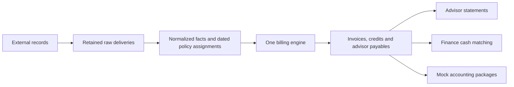

# Savvy Proto

Explore how Savvy could turn source records and commercial terms into explainable
bills, advisor earnings and Finance records. The prototype gives brokers,
Internal Product and Internal Finance a shared view of the same evidence.

**[Open the demo](https://savvy-proto.beanshop.top/) ·
[Explore the architecture](https://savvy.beanshop.top/) ·
[API reference](https://savvy.beanshop.top/api/)**

Start with the [Savvy review guide](docs/SAVVY-REVIEW.md). Both the affiliated
advisor and independent RIA use the same experience. Choose a business, open a
client group, inspect a dated invoice, then follow its calculation and cash evidence.
The demo is public. Start your own workspace to try changes in a separate copy. All client records and
commercial agreements are fictional; real Savvy disclosures have view/download
controls. Campfire and CLM are mocked. No real money moves.

Policies change through the API. The same engine handles both products,
recurring fees, approved one-time charges/credits and advisor compensation.
Native invoices, corrections and payout instructions stay in Savvy's data layer.
Cash confirmations and supplied recognition schedules remain separate evidence.

## What to review

| Audience | Starting point | Result |
|---|---|---|
| Brokers under either product | Client experience | Grouped clients, invoice lines, terms, earnings and confirmed payments |
| Internal Product | Processing and calculations | Source lineage, policy versions, one engine and retained work attempts |
| Internal Finance | Finance and Earnings | Native claims, cash applications, refunds and mocked recognition outcomes |

The [three-page architecture](https://savvy.beanshop.top/) explains the mental
model, technical components and billing engine. Click a component for details and
links to exact committed source. It includes executed examples from both products.

## Run and maintain

The full app runs on the owner's Mac with Next.js, Rails and PostgreSQL. Local
access is **http://127.0.0.1:3104/**. The Mac must remain powered, online and logged
in with Docker running for the hosted app to be available. The architecture and
API reference are independently hosted static documents.

Developers should read [AGENTS.md](AGENTS.md), the
[current handoff](NEW-SESSION-HANDOFF.md),
[preview operations](docs/DEMO-PREVIEW.md) and
[hosting/recovery](docs/HOSTING.md) before running setup or changing a deployment.
Existing data must be preserved; tests use separate disposable databases.

The [completion evidence](docs/FOUR-CAPABILITY-CLOSURE-VALIDATION.md) describes the
implemented scope and verification. Production identity, live source connectors,
real agreements, advisor hierarchy and MCP/WebMCP remain deferred. Supported
commercial compositions are policy data; new operator semantics require engine
work. The current API contract is **0.8.0**. GitHub Releases are the changelog.

Independent prototype maintained by Stephen Kall / Legume Labs. Earlier milestones
and the Python reference remain in the repository as historical development work.
