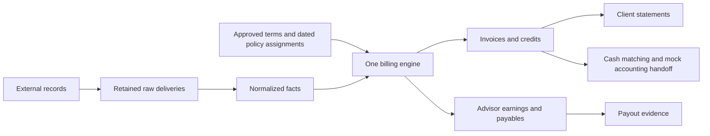

# Savvy Proto

An independent billing prototype for Savvy’s affiliated advisor and independent
RIA products. It shows how the same policy-driven engine turns source records
and commercial terms into explainable invoices, advisor earnings, and Finance
records.

**The goal is to help advisors estimate what they’ll earn before billing closes.**
**Earnings** shows the latest calculation and its data cutoff alongside
approved payables and confirmed payouts. The featured advisor example uses
issued fees. Validating an open-period forecast through close still requires
Savvy’s daily data, actual agreements, and a reconciled example.

## Start here

| Open | What to try |
|---|---|
| [Working demo](https://savvy-proto.beanshop.top/) | Choose **Advisor business** or **Harbor RIA**, open **Earnings** to compare estimates with payouts, or drill into an invoice under **Statements**. Use **Start your own demo** to try changes in a separate workspace. |
| [Architecture](https://savvy.beanshop.top/) | Explore the **Mental model**, **Components**, and **Billing engine**. Click a component to see what creates it and open the exact source. |
| [Evidence map](https://savvy.beanshop.top/evidence/) | Choose **Try one rollup**. Follow object creation from source delivery through invoice and report, and preview what each record can prove. The viewer also accepts JSON or CSV and exports a gap list. |
| [API reference](https://savvy.beanshop.top/api/) | Read the GraphQL contract, policy and billing commands, and download OpenAPI YAML or the schema. |

The demo and walkthroughs are public and open without signing in. The working
demo is hosted from the presentation device. The architecture, evidence map,
and API reference have separate hosting and remain available when the device is
offline. See the [15-minute walkthrough](docs/SAVVY-REVIEW.md) for a guided tour.
The [design decisions and validation](docs/DESIGN-DECISIONS.md) explain why the
system is structured this way and link each milestone to its evidence.

All customer and agreement records are fictional. Agreements includes real
public Savvy disclosures with view and download options. Campfire and CLM are
mocked. No real money moves.



Policies change through the API. The same engine handles both products, recurring
fees, approved one-time charges and credits, and advisor compensation. Savvy
owns its billing obligations, invoices, corrections, and payout instructions.
Cash confirmations and supplied recognition schedules remain separate evidence.

## What to review

| Audience | Starting point | Result |
|---|---|---|
| Brokers under either product | Client experience | Grouped clients, invoice lines, terms, earnings and confirmed payments |
| Internal Product | Processing and calculations | Source lineage, policy versions, one engine and retained work attempts |
| Internal Finance | Finance and Earnings | Native claims, cash applications, refunds and mocked recognition outcomes |

## Find the implementation

| Area | Start in |
|---|---|
| Intake, normalization, and retained source lineage | [Billing pipeline](apps/api/app/services/billing_pipeline.rb) |
| Policy assignment and evaluation | [Billing platform](apps/api/app/services/billing_platform.rb) · [Policy compiler](apps/api/app/services/billing_policy.rb) · [Shared engine](apps/api/app/domains/economics/engine.rb) |
| Native billing records and Finance | [Invoices and corrections](apps/api/app/services/billing_documents.rb) · [Payables](apps/api/app/services/billing_payables.rb) · [Cash and mock accounting](apps/api/app/services/billing_lifecycle.rb) |
| Demo, API, and evidence viewer | [Next.js app](apps/web) · [GraphQL schema](contracts/schema.graphql) · [Evidence map code](scripts/trace_workflow_cycle.js) · [Evidence map guide](docs/CAMPFIRE-TRACE.md) |
| What was tested | [Acceptance and current limits](docs/FOUR-CAPABILITY-CLOSURE-VALIDATION.md) · [Prototype checks](.github/workflows/ci.yml) · [Architecture checks](.github/workflows/architecture.yml) |

## Run a fresh clone

Install Docker with Compose and Node.js 22 or newer. In a fresh checkout, run:

```sh
./scripts/setup.sh
SAVVY_DEMO_SESSIONS=1 npm --prefix apps/web run start
```

Open [http://127.0.0.1:3100/](http://127.0.0.1:3100/) and use the **Business**
selector to explore both products. Setup loads the current fictional records
for statements, Finance, and earnings. The local API and database bind to
loopback ports 3101 and 55437.

To try **Queue period calculations** or deferred imports, run the billing worker
from a second terminal in the checkout:

```sh
docker compose run --rm api bundle exec rails runner script/billing_worker.rb
```

The [preview operations guide](docs/DEMO-PREVIEW.md) covers the separate
device-hosted demo. Read [AGENTS.md](AGENTS.md), the
[current handoff](NEW-SESSION-HANDOFF.md), and [hosting/recovery](docs/HOSTING.md)
before changing that deployment. Use disposable databases for tests.

Production identity, live source connectors, real agreements, advisor hierarchy,
and MCP/WebMCP are future work. Policy data configures the engine’s supported
operators. Adding a new operator requires an engine change. The API contract is
**0.8.0**. [GitHub Releases](https://github.com/stevekkall-beansgc/savvy-proto/releases)
records the shipped changes.

Independent prototype maintained by Stephen Kall / Legume Labs. Earlier milestones
and the Python reference remain in the repository as historical development work.
