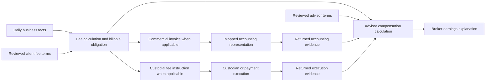

# Savvy billing, compensation and accounting ownership

14 November 2026. Research and architecture proposal only. Reviewed with Astra.
No application, database, service, provider or UI changes were made.

## Recommendation

Savvy should own the commercial billing and compensation objects that explain its
business: fee terms, calculations, billable obligations, invoice headers/lines when
applicable, account attribution, advisor earnings and commercial adjustments.
Campfire should hold the mapped accounting representation and accounting outcomes.
Custodians/payment providers supply execution evidence; Legal's contract process
supplies authoritative document versions and decisions.

Reuse Savvy's existing billing domain first. An invoice already owned by Savvy should
be extended or referenced, not recreated by this feature. Introduce a missing object
only after inspecting the actual model. A local copy of a Campfire response cannot
replace the operational relationships needed to explain a fee or compensation.

Local object ownership does not require moving every authoring action on day one:

| Existing reality discovered | Recommended first step |
|---|---|
| Savvy already creates commercial invoices | Reuse that object, IDs and current export path |
| Savvy creates fees/instructions; Campfire issues the formal invoice | Keep Savvy fee authority and a linked local invoice model; preserve current issuance/numbering ownership until an explicit migration decision |
| An integrated billing provider computes or issues part of the bill | Retain the provider's authoritative facts in Savvy's domain and preserve its IDs; extend only missing attribution/history rather than duplicate calculation |

The recommendation is a coherent Savvy data model and clear field authority. It
does not require rewriting a working billing service or changing the invoice issuer
to make a compensation forecast possible.

Our previous proposal incorrectly grouped invoice ownership with accounting
workspaces. Removing Collections or Reconciliation navigation does not require
giving commercial object authority to the ERP. Screen ownership, object ownership
and field authority are separate decisions.

## Evidence and its limits

| Evidence | What it establishes | What it does not establish |
|---|---|---|
| Savvy's September 2026 announcement describes billing within its unified data layer | Strong support for native commercial billing context | Existing invoice tables, service boundaries or integration behavior |
| Savvy's technology page describes a system above custodians, with proprietary and integrated services | Unified product/data ownership can coexist with external execution | That Savvy implements every provider capability itself |
| Savvy's linked ADV, Item 5, pages 9–11 | Multiple agreement-specific fee bases, account grouping, billing periods and collection routes | Internal schemas, advisor revenue-share terms or accounting policy |
| CTO's original problem brief | Prospective advisor payment visibility from contracts and daily client data; current retrospective calculations outside the product | That Campfire creates commercial invoices or calculates compensation |
| Campfire invoice/payment/bank/webhook documentation | API representations and documented effects suitable for an integration investigation | Savvy's enabled modules, configuration, permissions or safe production write semantics |

Savvy explicitly includes billing in its common data model. This supports the
recommended ownership direction; it is not a reverse-engineered schema.
[Savvy announcement](https://www.savvywealth.com/community-as-infrastructure),
[technology platform](https://www.savvywealth.com/solutions/technology).

The ADV describes agreement-specific asset-based, fixed and other service fees,
household/account grouping, monthly/quarterly billing, advance/arrears timing and
proration. It also distinguishes common custodial fee deductions from direct
invoices paid by check/ACH. These client fee arrangements are not evidence of
individual advisor compensation agreements.
[Official ADV, Item 5](https://info.savvywealth.com/hubfs/Form%20ADV%20%2B%20CRS/Savvy-Advisors-ADV.pdf).
The linked 31-page PDF was retrieved and pages 9–11 visually checked. A local
reference is retained in `artifacts/ownership-research-20261114/`.

The CTO's November 12 brief identifies a forward-looking compensation problem,
including complex commercial offsets. It does not ask for a replacement billing
or accounting platform. Only the relevant business requirements were used; no
recruiting logistics or private correspondence were copied into this memo.

Savvy's World Builders article describes governed shared definitions, server-side
identity and reviewed writes. Its BigQuery/Salesforce discussion concerns GTM
analytics, not proof of the finance warehouse or billing schema. Adopt the principle
of shared definitions; do not invent an existing finance architecture from it.
[World Builders](https://www.savvywealth.com/builders-blog-posts/savvy-world-builders).

No Savvy source code, production schema, real invoices, signed agreements, Campfire
tenant or CLM was inspected. Campfire use is owner-reported. The conclusion is an
evidence-supported architecture recommendation, not a claim about existing tables.

## The domain should start before an invoice

Keep two kinds of commercial terms distinct:

- **Client fee terms:** what the client owes Savvy for a service.
- **Advisor compensation terms:** how eligible economics translate into advisor
  earnings, incentives, guarantees and approved offsets.

A targeted advisor-share promotion must not accidentally discount a client's fee.
Both schedules need versioned agreement references, but they are different rules.

Conceptual flow, subject to reuse of actual Savvy objects:

The arrows are conceptual data paths, not authorization to initiate any writes.
An accounting route for a custodial fee must also be specified by Finance; it may
use an accounting invoice/application or another supported posting route. Do not
post both for the same event. A forecast is not a billable instruction, invoice,
receivable, compensation approval or payment.

For prospective estimates, reuse the approved billing calculation in an explicit
provisional mode where possible. Do not wait for a finalized invoice merely because
compensation will later reconcile to one. Preserve the estimate-to-final-bill bridge,
rather than adding forecast and actual amounts together. The present Ruby prototype
uses fixed fee observations; it is not yet this daily asset-to-fee integration.

## Proposed object and field ownership

| Object or fact | Business authority | Savvy data-layer responsibility |
|---|---|---|
| Client, household, account, service and dated advisor assignment | Existing Savvy operational sources | Canonical IDs, roles, relationships and history |
| Agreement operational record and structured terms | Savvy domain, validated against Legal's document | Parties, applicability, configuration/version and document reference |
| Negotiated/signed document and signature evidence | Legal repository/CLM or actual legal process | Version/hash/status mirror and proposal/approval links |
| Fee calculation, concession and approved billable obligation | Savvy billing domain | Inputs, exact amounts, service periods and corrections |
| Commercial invoice and lines, when applicable | Savvy billing domain | Canonical commercial identity, debtor, approved lines, document reference and revisions |
| Custodial fee instruction | Approved Savvy billing/execution workflow | Instruction ID, billed accounts, amount, approval and response lineage |
| Advisor earned amount, guarantee and commercial offset | Savvy compensation domain | Terms, eligibility, adjustment basis, examples and obligation history |
| Coverage grant and its consumption | Savvy commercial domain, with Finance-approved funding/credit basis | Direction, eligible obligations, atomic usage and remaining entitlement; no implied new cash |
| Funding, loan carrying balance or actual payment | Identified finance/execution source | Evidence-backed mirror and linkage; source authority must be confirmed |
| Accounting invoice, AR application/credit, journal and recognition | Campfire/verified accounting process | Scoped provider IDs, reported facts, source revisions and as-known history |
| Transfer acceptance, deduction, return and bank settlement | Relevant execution source | Normalized evidence with source aliases and stage-specific status |

Savvy owning a commercial invoice does not make its local `paid` flag authoritative
over bank settlement. Campfire owning accounting AR does not make its product record
the authority for account attribution or advisor promotional eligibility.

For an invoice, Savvy controls approved commercial lines, service dates, debtor,
terms references, allocation and commercial correction intent. Campfire controls
its accounting IDs, journal links, booked adjustments and reported accounting
application/AR/recognition facts. Payment sources control execution events. Local
display totals can be derived, but must remain distinguishable from source-reported
facts and carry their freshness/coverage.

Keep commercial approval, issuance/delivery, integration progress, accounting
application and settlement as separate axes. Select one document-numbering and
delivery owner; two representations must not send two invoices to a client.

## Relationships required for a useful invoice object

Do not impose customer → invoice → one broker as a universal hierarchy.

- The legal debtor, account owner, household and advisor are distinct roles.
  Household membership alone does not establish who owes the bill.
- A fee line retains the service, account/valuation basis, period, entity, currency
  and fee terms version. An invoice groups lines under applicable billing rules.
- Accounts/households and compensation recipients connect through explicit dated
  allocations. An invoice can span multiple accounts/services or advisor assignments.
- A receipt can cover several invoices and an invoice can receive several payments.
  Allocation bounds and unresolved residuals remain explicit.
- A provider may receive summarized accounting lines, but Savvy retains the detailed
  bridge and reconciles its sum. Do not discard compensation grain at export.
- Apply the attribution and rate date basis defined by the agreement. Today's
  account assignment or invoice creation date cannot silently replace service-time
  attribution on an older fee.

These are proposed capabilities, not assertions of actual Savvy schema cardinality.

## Non-invoice economics stay close to compensation

Advances, prepurchased rights, guarantees, rent/support/marketing allocations and
loan repayments should not all be represented as invoice lines merely to fit an ERP.
Savvy should own their commercial interpretation and eligibility; the relevant
finance sources own booked treatment and actual funding/payment evidence.

For example, earned compensation and the remaining coverage entitlement are business
facts needed to explain an expected payment. Applying previously funded coverage
does not create cash again. Opposite-direction obligations remain separate. A
guarantee creates a period-level compensation adjustment under its approved basis.
A loan requires an actual loan agreement and authoritative balance/schedule; an
advance label alone does not establish one. Rent or payroll-related support costs
can come from AP/payroll while the advisor's agreement determines any allocation.

This supports retaining domain records and calculations without retaining a
standalone Settlement desk in the product navigation.

## What Campfire's documentation supports

The invoice creation contract contains `source`, `source_id` and `integration_id`
alongside invoice/line data. Its documentation describes automatic AR journal
creation, and lists draft among payment statuses. This makes an upstream Savvy
commercial invoice plausible. It does not establish source-ID uniqueness, create
idempotency or the exact effects of staging/finalization in Savvy's tenant. A draft
label is not a substitute for testing those effects.
[Create Invoice](https://docs.campfire.ai/api-reference/accounts-receivable/create-invoice).

Invoice listing supports entity and exact invoice-number filters and returns source
references. That can help investigate a timed-out create; matching the number alone
does not prove identity. The same endpoint's optional download mode triggers an
emailed export, so a future read connector must use ordinary listing without that
flag. [List Invoices](https://docs.campfire.ai/api-reference/accounts-receivable/list-invoices).

The payment listing exposes upstream external IDs, modified timestamps, invoice IDs
and void state for synchronization. This can populate a local read model without
making Savvy independently author accounting applications.
[List Invoice Payments](https://docs.campfire.ai/api-reference/accounts-receivable/list-invoice-payments).

Bank-feed ingestion can itself generate journal entries unless configured otherwise.
Webhooks can be duplicated/out of order. These facts require a single posting path,
deduplication and verified readback; importing every observation independently could
double-count the same movement.
[Post Bank Feed](https://docs.campfire.ai/api-reference/cash-management/post-bank-feed),
[Webhooks](https://docs.campfire.ai/guides/webhooks).

## Future integration invariants

1. Reuse existing Savvy billing/invoice identity and the current integration owner.
2. Freeze the approved commercial version and line-allocation manifest. Record a
   durable export intent with the source decision, then publish asynchronously.
3. Keep entity-scoped business-to-provider mappings, version, request fingerprint,
   provider receipt and acknowledgment. Do not assume all mappings are 1:1.
4. Resolve uncertain outcomes before retrying a create. Source fields aid mapping;
   they are not a proven exactly-once mechanism. No blind POST retries.
5. Consume accounting and execution evidence separately. Link multiple observations
   of one payment; do not count a custodian event, bank event and ERP application
   as three cash receipts.
6. A commercial amendment follows the verified update/credit/void lifecycle. A new
   version is not automatically another accounting invoice. Preserve posted history
   and closed-period correction policy.
7. ERP-side corrections create an exception against approved commercial truth, or a
   separately classified accounting-only adjustment. Neither side silently overwrites
   the other's authoritative fields.
8. Use one approved posting owner for each accounting event. Do not create an invoice
   journal and separately post the same AR/revenue through another integration path.

These are requirements for a later authorized integration, not operations performed
by this research. No particular posting treatment is selected here.

## Changes needed in our proposal and prototype model

| Current assumption | Revised direction |
|---|---|
| Campfire owns invoices as a blanket rule | Savvy owns applicable commercial invoices; Campfire owns mapped accounting facts |
| Invoice is linked equal-value evidence, one per charge | Discover actual bill/line relationships and use explicit allocation/mapping where needed |
| Fixed fee observations demonstrate full prospective calculation | Add a bounded bridge to the existing billing engine/source in provisional mode |
| Removing accounting tabs means removing financial objects | Keep the domain and lineage; show only useful contextual evidence |
| One rate model can imply both customer and broker pricing | Separate client fee terms from advisor compensation terms |
| Every contract needs an external CLM-owned business record | Keep Savvy's operational agreement/configuration; link Legal's actual document process |

The prototype's `Workbench#link_invoice` enforces one equal-value invoice per charge
and stores an offline fixture reference. That is a tested demo simplification, not
a model of Savvy's billing system. Its generic JSONB evidence store is not a final
normalized invoice domain. The pure compensation engine and exact-money/history
invariants are useful foundations; they should consume the right business objects.

Keep the proposed broker Earnings/Agreements and narrow internal experiences.
Contextual fee/invoice details are valuable inside an earnings explanation. A new
general collections or reconciliation navigation section still does not follow.

## Discovery and next bounded proof

Before schema design, request a walkthrough of one completed billing cycle and its
existing models/integration. The decisive questions are:

1. Which existing objects own fee calculations, approved charges, invoices/lines,
   custodial instructions, concessions, revisions and document numbers?
2. How are client, household, account, legal debtor and advisor allocation connected?
3. What billing code and data can be reused for a prospective estimate? How do
   proration, timing, corrections and missing valuations behave?
4. Which exact basis makes each compensation component eligible: earned fees,
   invoiced amounts, deductions, collected cash or another approved measure?
5. What reaches Campfire today, at what grain, through which posting owner? What
   creates a journal, and how are returns/credits/closed periods represented?
6. Which upstream IDs and provider guarantees permit safe retries and readback?
7. Which sources own grant rights, actual funding, loans and recorded deductions?
8. Which agreement/document version and decision authorize the structured rules?

Use the answers to map existing objects before adding new tables. The next offline
proof should show an invoice-backed fee and a custodial-instruction fee, both linked
to Savvy-owned billing lines; a compensation estimate before completion; one mapped
accounting representation; and a correction preserving earlier versions. All provider
behavior remains fixture-driven until separately authorized. The success metric is
a defensible prospective payment explanation, not the number of finance screens.
