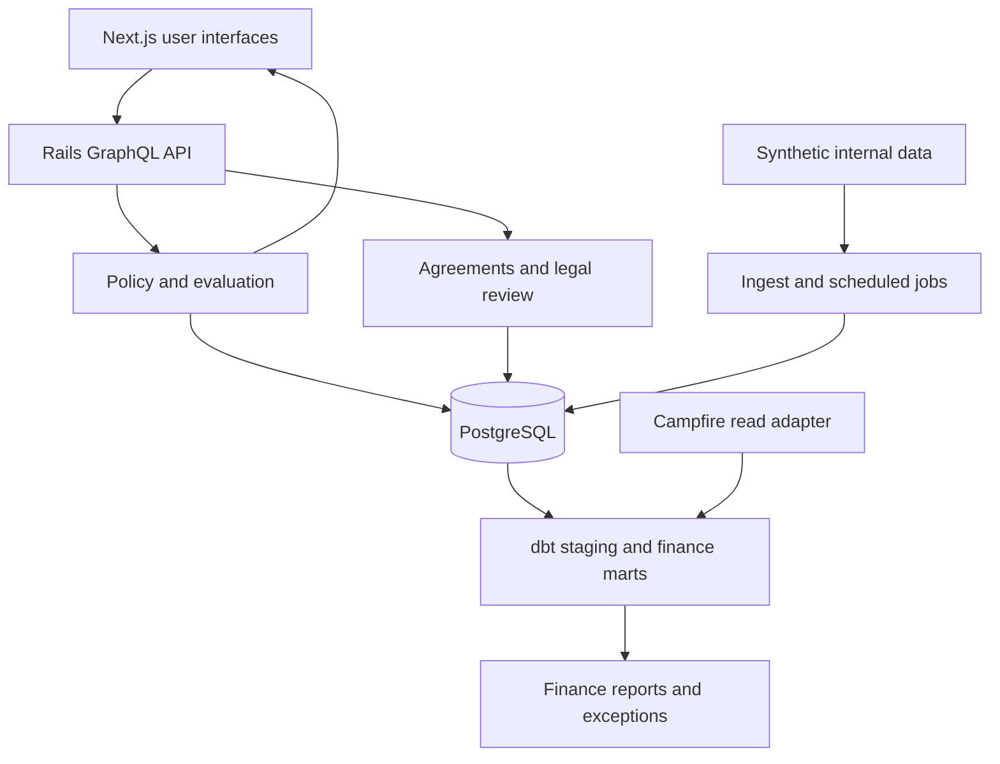

# Advisor Economics Workbench — full technical and execution plan

> Continuation note (13 November 2026): the local build has resumed. See [current implementation status](CONTINUATION-STATUS.md) and [validation](VALIDATION-CONTINUATION.md). Planning and earlier prototype descriptions below are historical; publication remains paused.

**Status:** planning only · 13 November 2026 · independent synthetic demonstration. No Savvy codebase, data, Campfire tenant, accounting policy or credentials have been inspected. No live connections, writes, share, deployment or send are authorized by this plan. The earlier publication pause remains in effect. This document is the execution handoff; [technical specification](TECHNICAL-SPECIFICATION.md) is supporting detail, and [evidence register](EVIDENCE-AND-SCOPE.md) records what is known.

## 1. Product objective and evidence boundary

**Objective.** Provide a broker-led workbench to configure advisor commercial arrangements, project and explain customer-level economics daily, reconcile customer charges and collections, roll outcomes up to brokers, and support accountants working in Campfire. Customer relationships and commercial policy live in the internal application; Campfire is the target accounting workspace for revenue recognition and, where supported, cash reconciliation. A dbt project produces auditable finance crosswalks and reporting from authorized replicas. Legal receives draft clause language and calculation examples to review.

**Known from Savvy invitation:** advisors have revenue shares, a simple 80/20 example and more complicated potential arrangements for rent, support, marketing and loan repayment; the firm says it has daily data about advisor client assets, market movement and client gains/losses; current advisor payment estimates are retrospective and use spreadsheets/manual work. Staging/code/data access was offered in a proposed trial, not granted to or inspected by this project.

**Owner-requested design:** primary broker experience; customer-level cash and financial detail; internally owned broker–customer relationship and optionally synchronized accounting representation; standard/promotional baseline, granular rate override, prepaid arrangements in both directions, flexible post-hoc guarantees; policy changes in UI for supported rules; synthetic source adapter with no new broker dependency; Rails/Next.js/PostgreSQL/GraphQL; Campfire-first accounting and dbt finance layer. These are desired capabilities, not assertions about actual Savvy contracts or workflows.

**External evidence, not verified tenant details:** Savvy publicly lists Rails/React/Next.js/PostgreSQL/GraphQL in engineering roles and says its platform is multi-custodian. User reports Campfire use; no tenant/module/API access verified. Campfire documents customer/vendor records with a parent field, contracts and revenue recognition; parent semantics, historical rollups and dual customer/vendor roles are not verified. Public evaluation sandboxes are offered on request, not a confirmed free/self-serve developer entitlement. See SOURCE-REGISTER.json and sources §24.

**Unknown:** exact service and charge types, legal payer/payee and customer/household/account definitions; fee/invoice/settlement basis; individual agreements and accounting decisions; source fields, controlled dimensions, identity relationships, correctness and freshness; datastore and access; Campfire modules, policies, dimensions and native object semantics. Never infer them from an example, customer name, observed value or public marketing.

## 2. What “done” means

The first release is a private, synthetic, end-to-end demonstration, not production or a clone of Savvy's systems. It is done when a reviewer can:

1. Configure fictional broker agreement and customer service agreement, with human-readable language, standard/promo/overrides, dated relationships, prepaid coverage in both directions and an explicit guarantee.
2. Load a fictional internal daily batch; identify accepted, stale, missing, unallocated and conflicting records; no broker-provided file or actual credentials required.
3. Run a deterministic day-specific projection and see customer → broker lineages, winning rules and reasons; cannot quietly fabricate a value.
4. Record fictional approved charge before an invoice, match customer-attributed cash operationally, later link invoice and evidence without double-counting, and show what is still unknown.
5. Produce a draft Legal review packet and reproduce the same calculations from pinned inputs; demonstrate at least two policy changes without code modifications.
6. View separate earnings/billing/coverage/cash/AR/recognized/guarantee/payout measures and explicit unknown states; identify owner and next action for exceptions.
7. Run dbt sources, tests and finance marts over synthetic PostgreSQL data; trace customer charge → receipt application → broker attribution → optional Campfire mock records.
8. Inspect sample Campfire data through an offline adapter. Demo contains no live provider access and no external posting, payment or signature.
9. Run automated financial, API, integration, dbt and browser acceptance tests from a clean checkout, plus local setup/readme. No factual claim of full GAAP compliance.

**Not required for demo:** real Savvy data, contract execution, multi-custodian integration, live pricing, real legal decisions, real accounting posting, auth-grade multi-tenancy, production ledger, FX conversion, tax/payroll, audit certification, or every conceivable commercial mechanism. The architecture must expose unsupported operations as explicit exceptions, not silently approximate them.

## 3. User roles, artifacts, and scope

| Role | Primary work | Boundaries |
|---|---|---|
| Finance operations | Configure terms and identity mappings; review daily inputs and charge/cash exceptions | Draft and propose; approval rights defined per tenant in production |
| Controller/accountant | Accounting assessment, recognition, cash reconciliation, close, Campfire evidence | Campfire target for recognition and accounting; no autonomous posting in demo |
| Legal | Review clause text, negotiable points, precedence, financial examples | Review is not signature, execution or accounting classification |
| Advisor/broker | See authorized book, customer outcomes and payout rationale | Access scope and permitted customer detail must be explicitly decided |
| Admin/data owner | Approve dimensions and mappings, monitor batches, manage demo config | No externally sourced or inferred dimension becomes a financial rule without approval |
| Engineer/operator | Maintain adapters, catalog, tests, releases, incident handling | No silent overrides of accounting or policy controls |

Demo roles are simulated; the demonstration must not imply production-grade authentication or role enforcement. Production requires tested auth, tenant/entity scoping, least privilege, field-level confidentiality, segregation of duties and auditable approvals.

**Deliverables:** working demo; synthetic reproducible input bundle; documented policy and data contracts; sample legal packet; finance exception/reconciliation views and dbt lineage; test suite and runbook; documentation with verified/unverified labels; separate deployment and Campfire decisions after user direction.

## 4. Architecture and source ownership



One Rails modular monolith and worker; one PostgreSQL demo database; Next.js/React UI. GraphQL boundaries and authorization in Rails, no second monetary calculator in browser. A distinct offline Campfire fixture adapter shares interfaces with future read-only live adapter. dbt runs in separate analytics schemas with access to read-only replicas or approved source views. No new broker API/feed or production broker work; future internal adapter and source ownership require discovery. Customer revenue recognition and accounting posting target Campfire where enabled and approved; do not create a competing subledger that posts duplicate entries.

Canonical local checkout `/workspace/sites/advisor-payout-explorer` is a Git repo with no remote; a new standalone private repository is proposed, not created. Existing Python/SQLite code is a synthetic reference; the user chose to rewrite in Rails, Next.js, Postgres, GraphQL. Public stack descriptions do not establish the actual target repo. Existing Site record is private/unpublished and static; it cannot by itself host Rails and PostgreSQL. Choose an appropriate private backend host after execution authorization and environment review; do not affect beanshop.top. Framework/runtime versions, auth provider, job backend and host not selected. The prior environment showed Node on PATH, not Ruby, psql or Docker; validate a suitable environment before committing to tools.

```text
apps/web/                     Next.js UI; no financial calculations
apps/api/                     Rails GraphQL API, domain modules, jobs
apps/api/app/domains/         relationship, policy, ingest, calculation,
                              agreement, cash, reconciliation, integration
apps/api/db/migrate/          PostgreSQL migrations
analytics/                    dbt project, staging, crosswalks, finance marts
contracts/                    GraphQL SDL, source contracts and event schema
fixtures/synthetic/           fictional agreements, daily facts and goldens
tests/acceptance/             user journeys, scenarios and Campfire fake
legacy/                       existing Python reference, if safely moved
src docs/ and scripts/         plan, assumptions, ADRs, seeds, reproducible run
```

**Non-negotiable boundary:** the proposed demo must not require an advisor to create a new feed. A future Savvy-internal adapter reads an authorized source. Even an internal source can depend on upstream custodians for fresh real-world balances; this design cannot eliminate that real-world dependency or manufacture missing values. Never infer flows/market movement from balance changes alone.

## 5. Canonical identity and relationship requirements

Terminology: a party can be a person, trust, company or other organization and may hold more than one role. Broker/advisor is an operating and compensation role, not necessarily the same as a broker-dealer legal entity. Customer is the relevant contracting/paying party. Account is an operational account. Household is a reporting grouping, not necessarily a legal customer. Practice/DBA is not automatically a legal entity. Compensation recipient may differ from servicing advisor. A workspace/tenant and legal entity are distinct scopes.

- REL-01: Internal IDs are stable, immutable, tenant-scoped; external IDs map through `(system, object_type, entity, external_id)` crosswalks with explicit status and evidence. Names are never join keys.
- REL-02: Broker↔customer/account/service relationships declare roles (`servicing`, `originating`, `compensation_recipient`, or an approved extension), effective interval, recorded interval, provenance and approval. Current relationship does not rewrite prior attribution.
- REL-03: Customer service contract and broker commercial agreement are separate documents/versions/parties; a customer can have multiple accounts; an account can have joint parties; a customer can be connected to multiple advisors where valid.
- REL-04: Shared advisor economics use a separate approved allocation policy with weights; source fact × allocated amounts + explicit unallocated remainder reconciles to source, by entity/currency/version. Missing or conflicting relationships block only affected scope, never disappear from totals.
- REL-05: Customer→household→broker is not a fixed hierarchy. Rollups follow explicit dated links and declared calculation basis, with fanout prevention and evidence.
- REL-06: Campfire parent/child is an optional synchronization/reporting projection; internal relationship history remains authoritative. Confirm native hierarchy/rollup/multiple relationships, customer vs vendor, date effects and changing parent before implementation. Never create duplicate Campfire customers to force a hierarchy.
- REL-07: The primary target grain for economic reporting is customer × service engagement × service period × provider entity × currency, with links to account, advisor and source line where supported. If source is aggregate-only, retain original grain and mark approved allocations as allocated, not observed customer actuals.

## 6. Data and evidence model

All tables tenant-scoped with composite tenant foreign keys; authoritative operational writes in PostgreSQL transactions. `id` is UUID/ULID; source external IDs are strings. Store stable currency codes, nonnegative magnitudes + explicit direction for payment obligations, and signed adjustment semantics where appropriate. Use UTC timestamps plus business timezone and half-open effective intervals. Monetary amounts stored as decimal or integer minor units consistently per currency; rate/quantity high-precision decimals or rationals; no binary float. Fixed rounding mode/stage is a versioned policy choice, never guessed. Production roles restrict modifications to history/closed results; do not call application audit append-only tamper-proof without infrastructure validation.

### 6.1 Proposed operational tables and grain

| Entity/table | One record per | Essential data / constraints |
|---|---|---|
| `tenant`, `legal_entity`, `party`, `party_role` | Entity or role | source identity, legal currency, role validity, tenant scope. |
| `broker`, `customer`, `account`, `household`, membership | Entity and explicit membership interval | stable IDs, legitimate many-to-many relationships, not names as keys. |
| `broker_customer_assignment` | Broker × customer × role × validity × revision | effective dates, recorded dates, source, evidence, owner; reject unauthorized overlaps; no fabricated split. |
| `service_engagement`, `customer_agreement_version`, `broker_agreement_version` | Defined customer service or broker agreement version | parties, dates, source/reference, approved state, version/hash; separate contracts. |
| `clause_template`, `agreement_clause`, `review_decision` | Clause template/version; agreement-specific clause; review | original and draft text, parameters, link to policy version, legal/commercial approvals scoped to content hash. |
| `dimension_definition`, `dimension_value`, `dimension_assignment` | Approved field or assignment | data type, entity grain, values, owner, evidence, effective dates, recorded time and unknown state. |
| `metric_definition`, `metric_version` | Approved metric and version | declared grain, input/source, unit, aggregation, inclusion/filter, null and freshness semantics. |
| `policy_version`, `rate_rule`, `rule_selector` | Approved policy version / rule / predicate | standard, promo, override; component target, dates, specificity/priority, exact rate, rate meaning and date basis. |
| `prepurchase_grant`, `entitlement_entry` | Coverage contract; grant/consume/expire/reversal entry | payer, payee, beneficiary, unit, currency, eligible obligations, period, conversion rule, lifecycle; append-only reversals. |
| `guarantee_policy`, `guarantee_run` | Guarantee version; group × period × run | metric, scope/grouping, floor/cap/threshold, direction, formula/scale, stacking, amounts, prior adjustments. |
| `source_batch`, `source_record_revision` | Incoming batch; source record revision | schema/version, source keys, checksums, business time, observed/ingested timestamps, coverage/watermark, quality status and synthetic flag. |
| `daily_account_snapshot`, `economic_event` | Account × metric × business date × source revision; event | exact value/unit/currency, freshness, actual source grain; distinct from customer cash. |
| `charge_instruction_version` | Source charge line × revision | debtor role/customer/broker, customer agreement, entity/currency/service period, intended collection date, approval and actual evidence. |
| `calculation_run`, `run_input`, `result_line`, `rule_trace` | Frozen run; input ref; component line; selection trace | as-of, business period, scenario, policy/input hashes, engine version, candidates, reason, rounding, status. |
| `receipt_revision`, `receipt_application` | Source receipt revision; allocation to an eligible charge or invoice line | payer, currency, source IDs, dates, state, matched amount, evidence and reversals; enforce conservation. |
| `invoice`, `invoice_line`, `invoice_charge_link` | Accounting source object/version and linkage | external IDs, customer/entity/currency, status, explicit charge/line links; no automatic invoice creation. |
| `bank_transaction`, `bank_match_group`, `match_allocation` | Source transaction or supported match group | source revisions, timing, fees and evidence, customer receipt matches; aggregate deposit alone cannot identify payer. |
| `performance_obligation`, `recognition_observation` | Assessment definition / Campfire posted schedule or journal line | customer/service, policy, accounting period, entity/currency, external IDs; native Campfire authority where approved. |
| `advisor_obligation`, `settlement_observation` | Entitlement/payable/payment, not synonymous | eligible base, beneficiary, policy version, state, timing, evidence and prepayment links. |
| `reconciliation_case`, `approval_event`, `audit_event`, `sync_attempt` | Exception/decision/event/attempt | actor, status, timestamps, evidence, owner, as-of/version and action; no credential secrets. |

### 6.2 PostgreSQL constraints and indexes

Unique tenant-scoped source `(source, object_type, external_id, revision)` and `(tenant, idempotency_key)`; valid start < end; defined ISO currency and units; rate denominator >0; allocation magnitudes bounded; immutable activated agreement/policy version (new version for amendments). Use exclusion constraints only for genuinely single-valued overlapping validity; legitimate joint accounts or shared advisors may overlap. Arbitrary selector conflicts require policy validation, not just a database uniqueness index. Index fact joins `(tenant_id, entity_id, customer_id, economic_date)`, relationships `(tenant_id, customer_id, valid_from, valid_to)`, source identity and Campfire IDs, plus run IDs. Evaluate actual query plans/volumes before partitioning. Enforce entitlement balance under row locks/serializable retry; unique settlement source identity prevents duplicate processing. Schema is proposed; migrations and operational checks not yet implemented.

## 7. Configuration model and UI behavior

### 7.1 Controlled dimensions

The platform supports a registry but ships with no claim of real Savvy segments. Each dimension has stable ID, display label, applicable grain, data type, allowed values, source/owner, version, validity, approval and evidence. Fictional `customer_type` and `product_type` demonstrate override behavior only. Distinguish unknown, not supplied, unmapped and not applicable; wildcard applies only when the policy explicitly allows it. Explain whether a rule is matched on event time, service date or another approved basis. A user may change existing parameters, filters, timing, priority, floor or ceiling without a code deployment; a new calculation mechanism, new source semantics or unsupported metric can require engineering.

UI flow: select source and define meaningful metric/role → draft rule → specify eligible scope and override target → preview affected and sample calculations, conflicts and impact → add clause text → legal/commercial review → approve exact hashes → effective-date activation → create recalculation or review case. Editing after review invalidates affected approvals. Automated suggestions can propose, never approve or execute. Validate typed allowlisted expression AST with restricted operations/depth, units, complexity, metric dependency DAG and safe filters; no arbitrary SQL, executable strings or free-form LLM policy.

### 7.2 Rate precedence and tests

For each transaction/component: (a) candidate active rules matching approved scope and selected business date, (b) most specific selector wins by containment, (c) if incomparable candidates require explicit approved priority, (d) otherwise broker promotional rule when active, (e) standard broker rule. A more granular matching rule overrides both standard and promotion for that component. Promotion is replacement, not a discount added onto another rate, unless an explicitly supported separate mechanism says so. A product rule does not erase an unrelated guarantee or prepurchase.

Examples: on $1,000 eligible base standard 80% → $800; valid promotion 85% → $850; matching product rule 90% → $900 even during promotion. A product-specific and customer-specific rule matching the same event are incomparable; absent explicit priority/intersection, validation blocks publication or affected calculation. Exact start/end times, timezone, date basis, and overlap rule are explicit in every scenario. Store candidates, winner, priority, date, version, source and reason per line.

### 7.3 Prepurchased arrangements

Support both broker prepays Savvy and Savvy prepays broker as explicit payer, payee and contractual obligation directions. Distinguish upfront cash, rate/volume entitlement, prepaid monetary credit, recoverable advance or other arrangement; labels do not decide accounting. Specify original amount or eligible units, coverage scope, rate/tier schedule, allowed conversion, validity, priority, exhaustion fallback, rollback/reversal, expiry, rollover, recovery and refund. For each result show billed/economic value, covered value, original upfront cash, incremental cash due, actual settled cash and remaining balance separately. Example $200 billed with $160 valid coverage → $40 incremental due; fully covered → $0. Never assume coverage itself is a new cash payment or automatically customer deferred revenue.

Partial consumption must split units correctly; covered activity may or may not advance the tier counter as policy explicitly defines. Multiple grants require deterministic precedence, locks, an idempotent allocation entry per obligation and exact reversals of original grants. A projection uses an isolated copy of the balance; no simulated run can spend or reserve actual coverage. True multi-currency and uncertain conversion are blocked until specified.

### 7.4 Guarantees

Guarantees are post hoc at the selected customer/broker/group/period grain. Required configuration: owning entity, beneficiary, eligibility filters and grouping keys, measurement metric/version and source requirements, service/event basis, aggregation (sum, count, average or supported ratio), unit, period/timezone/cutoff, floor/ceiling or conditional schedule, threshold, explicit conversion when measure and payment units differ, stacking/priority, directional settlement, exclusions, prepaid treatment, expected finality and true-up cadence. For an illustrative same-unit floor: `top_up=max(floor−eligible_earned,0)`; a zero denominator, missing metric or cross-currency comparison is an exception. A floor is not automatically a cap on total earnings. Prior top-ups and recovery terms matter: the new delta is approved current obligation minus previously approved obligation; don't post the full top-up twice. Nested/overlapping guarantees need explicit exclusive/additive/incremental ordering and cycle detection.

During a month, show earned-to-date, expected remaining, forecast full-period amount and forecast guarantee. Calculate the period guarantee once per group per snapshot; 30 daily forecasts are not 30 guarantees. Customer/broker-level grouping is explicit: two $100 per-product floors with A=$50 and B=$150 give $50 top-up; one pooled $200 floor gives $0.

## 8. Customer charge, collections and cash matching

Treat the existence of an upstream “we are charging X” record as a user-suggested hypothesis, not a verified Savvy fact. Support synthetic `charge_instruction` before invoice, with actual debtor role (customer or broker), approved status, source reference/version, service period, amount/currency and intended collection date. Separate expected/projected charge from approved-for-collection instruction, invoice, unconditional AR under accounting policy, payment, bank settlement and revenue recognition.

**Three match operations:** (1) customer charge/obligation ↔ customer-attributed receipt application; (2) receipts/processor batch ↔ bank settlement with documented fees, refunds, timing and clearing; (3) economic or collected customer amount ↔ broker per approved effective-dated compensation policy. Matching a payment operationally to a charge before invoice does not imply it has been applied to an invoice in Campfire. A broker direct charge or prepayment remains a distinct debtor/party/settlement flow. A later invoice attaches to the original charge/receipt, not duplicate billing or cash. Conflicts, overapplications, ambiguous recipients, unidentified payer and missing IDs go to explicit exceptions. A customer credit is not cash and voiding an invoice does not prove a refund.

Worked fixtures: customer A approved charge $1,000, receipt $600, no invoice → $1,000 charge, $600 operational match, $400 unmatched expected charge; invoice/AR and recognized revenue unknown. Later $1,000 invoice and supported $600 application → $400 open invoice and one $600 receipt, not $1,200. A $1,600 processor batch with $30 confirmed fee and $1,570 bank deposit reconciles $1,600 = $1,570 + $30; deposit alone does not establish which customers paid. Customer A and B each invoiced $1,000, A pays $600 and B $1,000 → $2,000 billed, $1,600 customer-applied cash, $400 open, conditional on source evidence; broker compensation and revenue recognition are not inferred.

## 9. Accounting and Campfire operating model

Accountants' primary surface for recognition and ledger is Campfire, subject to tenant capabilities and approved accounting policy. Internal app generates operational commercial outcomes, source/lineage and match proposals, and reads back Campfire records/status for explanation; dbt does not post. A synthetic offline adapter must be the default. Confirm exact Campfire tenant identity, existing chart/entities, source ownership, settings, role, modules, API access and customer/contract/line mapping before any connection. No private access or posting is implied.

Maintain separate axes: contract executed; service performed/obligation satisfied; calculated and approved charge; billed/invoiced; cash received and matched; advisor earned/accrued/billed/paid; Campfire recognition schedule and posted journal; bank/GL reconciliation. These can occur in different orders. An invoice is not always revenue; cash or prepaid coverage does not itself establish revenue; account AUM is not firm revenue. Billing/cash/advisor split are not accounting recognition.

For each applicable revenue arrangement, Finance documents scope, contracting party, reporting entity, performance obligations, transaction price/allocations, constraints/changes, recognition over time vs point, and principal-versus-agent conclusion, with policy/version/evidence, based on current applicable authoritative guidance. Advisor share may be compensation, acquisition cost, consideration to a customer, liability/advance or other treatment depending on facts. No blanket gross-vs-net inference from the split, flow of cash, role label or user display. Customer prepayment and recoverable advisor advance have separate assessment and rollforward; do not assume both are deferred revenue or blanket asset treatment. Journal entries shown in the UI, if any, must be synthetic illustrative proposed examples conditional on documented policy, not authoritative accounting advice.

Campfire docs list customers/vendors, invoices, invoice payments, AR/AP, bank transactions, journals, contract/revenue and prepaid objects, but availability, semantics, permissions, customer granularity, generated posting behavior and reporting in Savvy's tenant are unverified. The API's customer/vendor create schema lists `vendor_type` and `parent`; a contract has `customer`, but parent rollups, multiple brokers, historical changes and dual roles need sandbox testing. Do not assume an advisor agreement should be a Campfire revenue contract.

Use exactly one posting owner per entity/accounting event/obligation. If native Campfire revenue recognition is approved, do not also create recognition journals. Campfire documents bank-feed operations that may generate journals; avoid duplicated cash-posting ownership. AP/AR payment application is not proof that a bank transfer was initiated or settled. Bank transaction, receipt, credit memo, chargeback, settlement, AP/AR application and journal state are independently matched. Entity/currency/period rollforwards only where definitions and evidence are complete:

`opening AR + invoices − eligible cash applications − eligible credits ± corrections = closing AR`;
`opening contract liability + approved additions − recognized release − refunds ± corrections = closing liability`;
`opening clearing + inflows − outflows ± corrections = closing clearing`.

These are proposed controls; particular treatment requires policy, completeness and Finance signoff. Period locks, maker/checker approvals, blocked incomplete data, explicit late correction vs current adjustment policy, reversal linkage, source-to-Campfire-to-GL tie-outs, and uncertainty handling are production gates.

### 9.1 Campfire phases

0. Public docs and offline fixture adapter only; no tenant, keys or writes.
1. Request an isolated evaluation sandbox with fictional customers, Revenue Automation, developer/API access, reset/seed and agreed duration/cost; Campfire vendor contact must not be sent without explicit authorization. Confirm account permissions, API usage and safety boundary.
2. Read-only inventory of synthetic objects, IDs, parent relationships, custom fields, schedules, invoice/receipt, journal and reconciliation outputs; test customer-to-broker reporting and preserve crosswalk.
3. Sandbox-only authorized synthetic submissions for test cases; verify side effects, posting/readback, idempotency, reversals and human approval with Campfire/Finance. Treat uncertain write outcome as UNKNOWN and reconcile before retry. No live secrets in source/logs or production data in demo.
4. Separately authorized actual-company discovery and sanitized historical comparison; only then controlled pilot and posting permissions with accounting owner approval. Never conflate evaluation with production authorization.

## 10. Daily data and projection orchestration

Design a versioned internal input contract, not a purported Savvy export. `source_batch`: source/version, source batch ID, tenant/entity, synthetic flag, dataset kind snapshot/event, business date, source watermark/observed timestamp, extracted timestamp, generated timestamp, expected and received counts if actually available, checksum, sequence/revision and state. Preserve authoritative source identifiers and nulls; test duplicate/reordered/late rows; do not assume every account belongs to one advisor, or that all activity is in one file. An account snapshot contains entity-scoped customer/account ID, date, approved metric value/unit/currency, source observed time and completeness; the account value alone is not billable AUM or revenue.

`source_adapter.load(snapshot_ref)` yields a normalized batch and diagnostics; initial implementation uses fixed-seed synthetic dataset. Mapping and customer dimensions require explicit approved source/owner and may be unavailable. Raw sensitive records stored only when necessary, encrypted in non-demo environments; no unapproved broker delivery requirement. Security context, scoped import, malformed files, row and size limits, file checksums, duplicate processing and quarantine are required before any non-demo use.

`DailyRun` freezes policy versions, input revisions and watermarks, source completeness, relationship versions, as-of and period boundaries, engine version, scenario and rounding policy. Manual run first; schedule once validated. Outputs are immutable projected snapshots. Same idempotency key + same canonical inputs returns original run; changed inputs conflict. `completed`, `partial`, `blocked`, `failed`, `superseded` reflect input and calculation state. No partial data presented as complete. Projections use isolated hypothetical balance snapshots and do not post or consume real entitlements. Late data generates a new linked run; prior 'as-known' view retained. Trigger after relevant cutoffs and watermark policy; never treat empty feed as zero.

## 11. Daily calculations: exact synthetic profile and trace

The following are **demo defaults proposed for validation**, not actual Savvy policies. Manifest `demo-policy-profile-v1` contains: USD only; America/New_York business timezone; service-date rate and attribution basis; inclusive start/exclusive end; rate replacement; money integer cents and exact rational/decimal intermediates; round half-up at final economic-line boundary; deterministic largest-remainder residual allocation with stable key; month calendar guarantee period; guarantee base is eligible earned advisor entitlement before prepaid application/cash settlement; projection is provisional and does not consume grants; actual demo settlement is an explicit separate action; missing required segment holds affected outcome rather than defaulting silently; expired grants cannot be reused without an explicit rule; late data creates a new run rather than rewriting a closed view. Visible on each run and review packet; no default silently upgrades into asserted legal/accounting truth.

**Evaluation pseudo-contract:**

```
INPUT  frozen policy+agreement versions, relationship history, source snapshot,
       scenario version, grant opening snapshot, valid time, knowledge time, timezone
CHECK  source scope and currency; state/approval; completeness; supported mechanisms;
       dimension mappings; effective intervals; scope allocation; unit compatibility
RATE   find eligible candidate rules; determine scope containment/priority; trace winner
CALC   calculate at economic fact/component/customer grain; keep precision and evidence
ALLOC  simulate hypothetical prepaid by approved direction, coverage scope and order
GROUP  aggregate approved guarantee metrics at configured window and grouping keys
TRUEUP compute provisional or final adjustment once per group; do not duplicate prior
OUTPUT line totals, prepay coverage, open amount, guarantee, exceptions, lineage/hash
```

The evaluator is a pure Ruby domain module with no network, database or UI calls. Rails services load/persist the exact snapshots in transactions; jobs orchestrate. Guard cyclic dependencies, e.g., a guarantee cannot derive its own base by including itself. Missing data cannot silently match wildcard or become zero. Final line and allocation output is reconciled to inputs, and inputs/explanation are retained. Versioned policy expressions must name approved metrics and their units, not arbitrary SQL or Ruby.

**Represent stages independently:** charge authorization, billing/invoice, receipt evidence, operational preinvoice match, invoice application, bank reconciliation, advisor entitlement, prepaid coverage, guarantee, recognition, publication/close. A single `paid` or `revenue` flag cannot cover these. Every stage carries entity, currency, business period, source date, observed/recorded time, as-of, lineage and unknown/incomplete reason. A matching status cannot be reused to assert settlement or recognition.

## 12. Draft legal review and commercial operations

Clause-template library has broker standard, promotion/fallback, granular override/precedence, broker-to-firm prepurchase, firm-to-advisor advance, fixed guarantee with metric/grouping, permitted costs/offsets, correction, definitions and priority. Each contains source language, draft suggested language, typed parameters, plain-language interpretation, unsupported terms, numerical examples, effective dates, edit provenance and test outputs. The platform generates a reviewer packet in a portable format (Markdown/HTML first; document format selection later) from an immutable manifest; does not auto-sign, send, publish or create legal obligations.

Separate statuses `draft`, `commercial_review`, `legal_review`, `approved_for_demo`, `activated`, `superseded`; `contract_executed` is separately evidenced and never inferred from a UI button. Approval binds document hash, compiled policy hash, fixture/example hash and relevant accounting assessment; substantive changes invalidate affected approvals. Legal and Finance review independently. Role demo may show simulated identities but must not claim verified Savvy permissions or SSO. Suggested roles: policy author, legal reviewer, controller, reconciler, advisor viewer, auditor and demo admin; a real deployment must enforce permission at GraphQL object/field, exports and worker scopes—not UI alone. Granular finance/advisor information and relationship graphs must not leak on guessed IDs.

## 13. API contract and error semantics

GraphQL `/graphql` via Rails is the target; operations below are proposed and not an assertion about Savvy's existing API. Read projection `customer360(customerId,period,knowledgeCutoff)`, `brokerBook(brokerId,period,asOf)`, `agreement(id,version)`, `policyEvaluation(id)`, `sourceBatch(id)`, `cashMatch(id)`, `recognitionEvidence(customerId,period)`, `reconciliation(entityId,period)` with cursor pagination. Mutations `createAgreementDraft`, `proposePolicyVersion`, `validatePolicy`, `simulatePolicy`, `recordReviewDecision`, `activatePolicy`, `importSyntheticBatch`, `startProjection`, `recordSyntheticReceipt`, `proposeOperationalMatch`, `approveOperationalMatch`, `linkInvoiceEvidence`, `startReconciliation`, `generateLegalReviewPacket`; no live posting/payment mutations in v1. Read-only Campfire sync is a future feature-flagged adapter, not a demonstration connection.

Use types `Money { minorUnits: BigIntString!, currency: String! }`, `DecimalString`, `Date`, `DateTime`, explicit business timezone and `Period { start, endExclusive }`; distinguish unavailable amount `null` + `UNKNOWN`/reason from zero. Synthetic scope and version IDs mandatory. Example mutation:

```graphql
mutation Project($input: StartProjectionInput!) {
  startProjection(input: $input) {
    run { id status inputManifestHash policyHash knowledgeCutoff }
    errors { code path message evidenceIds }
  }
}
```

```json
{"input":{"inputSnapshotId":"synthetic-batch-2026-11-13-r1","policyVersionIds":["demo-broker-v1"],"periodStart":"2026-11-01","periodEndExclusive":"2026-12-01","knowledgeCutoff":"2026-11-13T23:00:00Z","businessTimezone":"America/New_York","scenarioVersionId":"demo-baseline-v1","idempotencyKey":"demo-20261113-v1"}}
```

A queued asynchronous execution must not be reported as completed until output is committed; synchronous demo is allowed if explicitly labeled and behavior/tested. Same tenant+actor/integration+operation+idempotency key and same canonical request returns existing operation/result; same key/different hash fails `IDEMPOTENCY_CONFLICT`; different tenants may not access each other's keys or records. Operational model errors use typed safe errors `UNRESOLVED_MAPPING`, `INCOMPLETE_SOURCE`, `STALE_SOURCE`, `RULE_CONFLICT`, `UNIT_MISMATCH`, `UNSUPPORTED_MECHANISM`, `PERIOD_CLOSED`, `ALLOCATION_EXCEEDED`, `HASH_CHANGED`. Authentication/transport/system errors distinct; GraphQL queries limited by depth/cost, pagination and authorization. Raw exception payloads must not disclose sensitive records. Schemas and golden sample requests live in `contracts/`.

## 14. Job contracts, retries and state

| Job | Input | Idempotency/completion behavior |
|---|---|---|
| Synthetic generator | version, fixed seed, date range, named cases | Same parameters/seed produce byte-identical fixtures with manifest/hash; independent economic goldens are hand-calculated. |
| Import | source/batch ID, tenant, expected checksum, schema | Same source record ID/revision/hash is duplicate; conflicting payload quarantined. Protect bytes/rows; source tenant not caller-inferred. |
| Normalize/map | accepted batch + approved mapping versions | Unknowns remain unknown, assignment/evidence traced; no name-based auto-linking. |
| Freeze | complete-or-explicit-partial input manifest, cutoff | Records exact source revisions and watermark; preserves stale and missing status. |
| Evaluate | frozen snapshot, policy/version, scenario, grant opening view | Deterministic, no external writes; output+run status committed atomically. |
| Operational match | receipt/charge candidates, exact scope, evidence | Proposal vs approved decision; enforce concurrency and prevent overapplication. |
| Accounting evidence import | synthetic Campfire object revisions | Deduplicate; no proof that a payment application is bank settlement. |
| dbt publication | frozen source and extraction manifests | Run selected build/tests, materialize isolated release, publish only passing scope with version/watermarks. |
| Future Campfire read | authorized tenant, endpoint allowlist, watermark | GET-only after validating side effects; opaque pagination constrained to verified origin/path; no arbitrary user-supplied URLs. |

`run_state`: queued/running/completed/partial/blocked/failed/superseded, with source count, amounts and unresolved counts. Retries happen only on transient faults; source/data/policy errors are review tasks, not infinite retries. Input idempotency and output publication must survive process crash. Financial output generation is never triggered by an unaudited UI view or preview. Future external write flow would require separate outbox, approved payload hash and uncertain-outcome reconciliation; timeout yields `UNKNOWN`, never blind retry.

## 15. Campfire fit assessment and sandbox test plan

Public docs list customer/vendor records, `parent`, customer-linked revenue contracts, invoices, invoice payments, bank transactions/reconciliation, prepaid/usage and revenue objects. This does **not** prove parent hierarchy rollups, multiparent relationships, history, customer/vendor dual role, pre-invoice matching, customer-level schedule/API behavior, app extension placement or permission availability. Campfire's product material describes revenue recognition by customer/contract/product, which is a vendor claim to verify.

**Candidate representation:** internal party and effective-dated broker/customer graph owns relationships and compensation policy. Map each internally identified accounting customer or broker account to a tenant/entity-scoped Campfire customer/vendor ID. `parent` may be an optional single-parent reporting projection only after testing; don't use it as the only source of historical or shared attribution. Customer-facing service agreements and broker compensation agreements are separate; do not automatically map the latter to a revenue contract. Sync direction, conflicts, deletion, role collisions and cross-entity mappings must be explicitly chosen. Custom dimensions/tags may aid reporting, subject to validated support.

**Request:** vendor-provisioned isolated evaluation tenant with synthetic data, Revenue Automation, API access and account roles; ask price, duration, reset/reseed, approval, limits and app extension conditions. Public offer is vendor-built evaluation sandbox, not confirmed free/self-service developer signup. No outreach or signup in this plan.

**Read-only test script:** (1) list identities, customers, legal entities, object schemas and versions; (2) inspect one broker and two customer records and test `parent` readback; (3) inspect whether a customer contract points to its customer, whether broker-level vs customer-level records can coexist, and whether customer can also act as payable vendor; (4) create/inspect synthetic data only if sandbox permission and action are separately authorized; (5) verify partial receipts and bank match, including invoice absence; (6) inspect prepaid, schedules and changes, posted journal IDs, UI approval and period locks; (7) test drilldowns, history on reassignment, multiple advisors, category dimensions and rollup; (8) compare observed behavior to saved expected results and record pass/fail/unknown with exact tenant/scope/version/time.

**Read safety:** dedicated least-privilege API identity; validate GET action side effects, pagination and origin; rate limits and Retry-After; use local fixture cash classification policy and reject unknown live types; invoice download parameters may trigger email and must not be used without confirmation. Financial creation/write flows are not included in demo and require distinct authorization, ownership, Finance signoff and validated target semantics. Campfire docs advertise webhook HMAC events; treat as hints and fetch verified current state. Never store signing secrets in fixtures, code or logs.

## 16. dbt finance architecture

The project's `analytics/` dbt directory contains declared sources and schemas, staging models `stg_core_*` and `stg_cf_*`, intermediate effective-dated xwalks `int_identity_xwalk`, `int_broker_customer_effective`, `int_charge_receipt_match`, `int_broker_attribution`, `int_campfire_object_links`, finance marts `fct_customer_charge`, `fct_customer_cash_application`, `fct_broker_economics`, `fct_revenue_recognition`, `fct_cash_reconciliation`, `fct_preinvoice_charge_match`, `fct_accounting_exceptions`, plus customer/broker/account/entity dimensions and documented grains. These are proposed, not built. The actual source field names and any Savvy dbt project/warehouse are unknown.

Source contracts include scoped source IDs, business/observation/extraction times, source version, tenant/entity/currency, revision and status. Models never use names to join. Crosswalk key includes tenant, legal entity, source, object type, external ID, role, effective range and recorded cutoff. Approved internal relationships and policies remain upstream-owned; dbt consumes them. Multiple mappings produce exception facts, not arbitrary matches. Source and model tests enforce unique/not-null IDs, scope, currency and timestamps, allocation conservation, unmatched residuals and join cardinality. Filter and group by approved dimensions only. Unknown payer and aggregate-only source retain their original scope. Do not join the current broker assignment onto historical cash by default.

Incremental models require stable unique keys, source version and explicit replay/lookback for late records, delete/reversal behavior, as-of cutoff, and accounting close policy; full refresh must not overwrite approved closed historical artifacts. dbt snapshots record only changes observed when the snapshot runs; they cannot reconstruct unseen source events and do not replace source bitemporal history. Runs bind application/policy/engine/dbt version, source watermarks, knowledge cutoff and close version. Build in a separately permissioned analytics schema from read-only replicas/approved views, not unrestricted live OLTP reads; benchmark load and select actual warehouse later.

`dbt build` and tests run only after source readiness/watermark checks. Failed scoped tests block publication for affected outputs and create owner/next-step exceptions; raw facts remain available to authorized users. Production dimensions/PII use RBAC, masking and retention policies; seeds are synthetic only. Analytics/export models are reviewable candidate datasets; a separate authorized integration service performs any Campfire API operation. dbt must never post, move cash, silently rewrite a recognition or treat a match proposal as an accounting application.

## 17. Nonfunctional and controls requirements

| Category | Requirement | Demo vs later |
|---|---|---|
| Security | Synthetic-only data/environments, no live credentials, scoped access, no secret logs; production auth, field-level compensation controls, TLS/encryption and audit | Demo fictional guard; production controls required before real data |
| Tenant/entity isolation | Composite tenant/entity scopes across FKs, APIs, dbt and exports; denial at every graph edge | Enforced testable isolation; demo does not claim enterprise certification |
| Integrity | Exact arithmetic, immutable versions, valid intervals, no duplicate source ID+revision, no overapplication or consumption, balanced explicit allocation residual | Required in synthetic demo |
| Reproducibility | Freeze code/engine, policy, agreement, source revisions, relationship versions, timezone, as-of, scenario and rounding; replay yields same results | Required for demo receipt |
| Data quality | Missing vs zero, stale vs new, complete vs partial, unmatched data visible, deterministic validation and quarantines | Required |
| Reliability | Durable job state/idempotency, retries, dead-letter exceptions, atomic publication; projection does not mutate real balances | Required local behavior; production SLAs uncommitted |
| Observability | Structured logs, run/attempt IDs, metrics for freshness, blocked groups, variances, counts, missing mappings; no PII in logs | Basic demo run history; mature monitoring later |
| Privacy | Synthetic data segregated from real; minimum necessary fields, documented retention, deletion, access review and export controls for future real data | No real customer data during demo |
| Performance | Pagination, indexes, bounded queries; baseline targets to be agreed after volume/capacity discovery | Do not invent production SLA |
| Restore | Migrations, backup/restore drill and reproducibility artifacts | Required before real use/deployment |
| Close and audit | Hash-bound approvals, immutable close version, late adjustment/reversal, evidence linkage and accounting signoff | Model workflow in demo; no attestation |
| UI | Mobile/desktop usable, keyboard labels, accessible status, explanation and explicit synthetic tags | Validate representative views |

## 18. Acceptance scenario catalog

Every expected result is independent hand arithmetic and a synthetic contract assumption; none is a claim about Savvy. Test coverage maps `scenario_id` → fixture → UI/API/domain/dbt result → implementation status. Target USD-only, half-up demo as §11.

| ID | Scenario and test | Expected result |
|---|---|---|
| S01 | $1,000 eligible fees, 80% standard | $800 entitlement, winning standard rule trace |
| S02 | Same base, active 85% promotion | $850, correct start/end boundary |
| S03 | Same base, matching 90% granular override while promo active | $900; override wins; guarantee remains separate |
| S04 | Incomparable customer and product rules match with no priority | affected calculation blocked, conflict surfaced |
| S05 | No override outside promo window | standard fallback, not stale promotion |
| S06 | Customer type not supplied | explicit missing-dimension policy; never invent a segment |
| S07 | Broker prepay covers $750 of eligible $1,000 broker obligation | $1,000 billing; $750 coverage; $250 incremental due |
| S08 | Firm advance $1,500 applied to $1,000 advisor entitlement by approved terms | $0 incremental payout; $500 advance remains; original cash separate |
| S09 | Advance and opposite-direction broker obligation | both directions shown separately; no automatic netting |
| S10 | 100 units × $2, 80 units covered | billing $200; coverage $160; cash due $40 |
| S11 | Two parallel claims of $600 vs grant $1,000 | total actual allocation ≤ $1,000; other portion unresolved |
| S12 | $70 eligible earnings; $100 monthly floor | $30 top-up and $100 total, not a daily repeated guarantee |
| S13 | $200 earned, $160 prepaid settled, $180 floor on earnings | top-up $0; guarantee does not use $40 cash due |
| S14 | A=$50/B=$150, each $100 guarantee | individual top-up $50; pooled $200 floor top-up $0 |
| S15 | customer count metric with two accounts for one customer | distinct count 1; incompatible count-to-dollar formula blocked |
| S16 | $1,000 customer charge; verified $600 receipt; no invoice | operational match $600, expected balance $400, AR/revenue unknown |
| S17 | invoice $1,000 appears later, $600 application verified | one $600 cash event; $400 open invoice; trace links to prior charge |
| S18 | customer invoices $1,000 + $1,000; receipts $600 + $1,000; bank $1,570 + fee $30 | customer applied $1,600, open $400; bank bridge reconciles; no advisor compensation inference |
| S19 | receipt $500 where only $400 eligible charge remains | apply $400 only, $100 unapplied subject to source-supported payer |
| S20 | invoice differs from charge by $50 | discrepancy held; no hidden adjustment or duplicate receipt |
| S21 | earlier $600 receipt reversed after closed run | explicit reversal/new version, original as-of view maintained |
| S22 | customer reassigned advisor midperiod | use declared date basis; preserved known-at-time and corrected historical views |
| S23 | $1,200 customer prepay under approved 12-month illustrative policy | $100 first-month Campfire-observed recognition, $1,100 liability; no parallel posting |
| S24 | $2,000 recoverable advisor advance, $600 applied | $1,400 remains under synthetic approved policy; distinct from customer deferred revenue |
| S25 | invoice void but active cash; credit memo | do not assume cash refund; credits not cash |
| S26 | aggregate $10,000 bank receipt without customer evidence | entity-level unmatched only; customer details unknown |
| S27 | duplicate/conflicting source ID+revision | duplicate idempotent; conflict quarantined |
| S28 | equal rounding split $0.02 across 3 recipients | stable $0.01/$0.01/$0.00 and exact sum |
| S29 | Campfire native RR event + duplicate webhook | same journal recognized once, preserve evidence and retry safely |
| S30 | entity/currency mismatch or unauthorized advisor access | block; do not cross entity, convert, or reveal records |

Additional adverse cases: partial source, stale metadata, grant expiry/restore, multiple guarantees with stacking, mapping change and equal precedence, advance refund, late asset correction, negative adjustment and closed period, conflicting app/Campfire IDs, unavailable Campfire, incomplete schedule and amount tolerance, extraction checkpoints with late and deleted rows, test-data production guard, unmatched/cross-customer cash, account shared with multiple advisors, changes in entity, tenant and role privileges, profile update to approved policy, withheld dbt publication. Every error returns specific impact and owner; expected no-silent-zero/no-double-count properties are tested at domain, database and dbt layers.

## 19. Phased execution and concrete gates

| Phase | Build tasks | Exit evidence | Prerequisite |
|---|---|---|---|
| 0. Decisions | Approve synthetic profile, identity/units, guarantee semantics and 30 golden fixtures; label unknowns | Reviewers can calculate S01–S30 by hand; source/fact registry updated | This plan, no private data |
| 1. Foundation | Repo layout, Rails/Next/GraphQL/Postgres, local isolated DB, source contracts, fictional role shell | Clean checkout runs setup; test DB, health, synthetic scope and CI | Runtime/host/dependency availability checked |
| 2. Relationships | parties, legal entities, broker/customer/account links, assignment history, mapping screens | Transfer/shared allocation and scope tests pass; no assumed segments | Phase 1 |
| 3. Policy | versioned clauses, standard/promo/override, precedence/validation, pure Ruby engine, traces | S01–S06 and rounding pass; policy changes are configuration-only for supported rules | Phases 1–2 |
| 4. Ingestion + runs | synthetic batch generator/ingest, quality gating, snapshots and replay | repeated/late/stale/unknown samples show correct state; same snapshot deterministic | Phases 1–3 |
| 5. Charges + collections | instruction and payment axes, pre-invoice matching, invoice links, bank bridge, broker rollup | S16–S22, S25–S27 pass end-to-end without duplicate cash | Phases 2–4 |
| 6. Prepay + guarantees | directional grant/consumption/reversal; typed metrics, group/windows/true-ups | S07–S15 pass, atomic application and projection isolation | Phases 3–5 |
| 7. Legal + workflow | clause templates, review packet, version-hash approvals, role views | edited policy invalidates approval, explainable synthetic packet | Phases 3–6 |
| 8. Accounting + Campfire fixture | offline adapter, customer recognition evidence/rollforwards, accountant trace | S23–S30, no posting/payment action; no native/custom duplicate | Phases 4–7 |
| 9. dbt finance | staging/xwalks/marts, docs, grains, tests, run watermark | dbt build/test pass, conservation, no fanout; a broker total traces to customer and source | Phases 2–8 |
| 10. Private deliverable | usable review UI, tests, setup, demo walkthrough, deployment options | clean checkout/build, 30 goldens, API/browser/dbt checks and known limits | Phases 1–9 |
| 11. Optional Campfire sandbox | separately obtain isolated vendor tenant and synthetic-only credentials, validate native model | written fit evidence, source mappings, role side effects, no duplicate posting | Separate approval/access and Finance review |
| 12. Real Savvy discovery | inspect authorized code, customer/source schemas, contract, chart and accepted historical period | Finance-accepted reconciliation and migration design | Savvy consent, actual access and data permissions |

No real provider account/transaction, externally shared website, or live finance write is implied by completion of phases 0–10. Publication remains paused until user changes that direction. Phases 11–12 do not block an offline synthetic demonstration but are required before live integration or asserting actual Savvy accounting accuracy.

## 20. Verification strategy

- **Unit/domain:** independent hand-worked examples, exact arithmetic, priority partial order, boundary times, unsupported rules, metric dependency cycles, propagation of unknowns, immutable versions. Property tests for conservation, deterministic ordering and no double-count.
- **Database/integration:** source uniqueness, effective-date constraints, tenant scoped FKs, concurrent consumption and receipt applications, transaction rollback, idempotency and optimistic approval concurrency. Use actual Postgres semantics in CI, not SQLite alone.
- **API:** GraphQL types, authorization at every field/relationship, pagination, retry conflicts, errors, scoping, provenance, no unexpected external effects, status/amount distinction.
- **UI:** broker and customer drilldown, policy configuration, ambiguity and missing evidence, legal packet, trial run, collection without invoice, later invoice matching, recon UI, desktop/mobile accessibility. Values must be visibly fictional.
- **dbt:** compile/build/test on synthetic Postgres, definitions and documented grain, uniqueness, allocation and unmatched totals, fanout, materialization/idempotency, late/backdated evidence, prior-close reproducibility. No dbt SQL mutation of transactional source/ledger and no external API.
- **Accounting:** independent posted-like synthetic examples under explicitly approved illustrative accounting policy; reconcile cash, AR, deferred and advances with documented opening/closing scope, no recognition from billing/cash without evidence; no implied real GAAP approval.
- **Observability/security:** restricted demo-only environment, no secrets in repo/logs, invalid file and body size, deterministic fixture seed, audit hash binding, restore runbook, API timeout marked unknown in future live code.
- **Verification record:** exact commit and commands, pass/fail/skipped/unrun, environment, timestamp and limitations. A test count does not prove actual contract fidelity, legal correctness or production readiness. No test, deployment or framework installation has been performed for this plan.

## 21. Proposed service-level API examples

The proposed GraphQL schema starts with opaque IDs, explicit strings for big numeric units, null/unknown state and per-result errors. This is a design contract, not compiled code or Savvy's schema.

```graphql
scalar DateTime
scalar BigIntString
scalar DecimalString

type Money { minorUnits: BigIntString!, currency: String! }
type DomainError { code: String!, path: [String!]!, message: String!, evidenceIds: [ID!]! }
type CollectionState {
  charge: Money
  receiptObserved: Money
  operationalMatched: Money
  invoiceApplied: Money
  bankSettled: Money
  recognizedRevenue: Money
  completeness: String!
  unresolved: [DomainError!]!
}
input StartProjectionInput {
  inputSnapshotId: ID!
  policyVersionIds: [ID!]!
  periodStart: String!
  periodEndExclusive: String!
  knowledgeCutoff: DateTime!
  businessTimezone: String!
  scenarioVersionId: ID!
  idempotencyKey: String!
}
```

`startProjection` returns run ID/status/input-manifest hash/policy hash; queue status not success. For each result: customer/account/broker and source grain, source record/revision, policy candidates/winner, exact amount, expected/prepaid/cash state, guarantee and trace. `customer360` exposes charge, invoice, receipt, matching, Campfire recognition and broker allocations as independent values; `brokerBook` rolls up only authorized, compatible and fully scoped values and shows explicit unallocated totals. `proposeOperationalMatch` cannot mutate bank/AR; `approveOperationalMatch` records an internal match only; `linkInvoiceEvidence` does not create cash; `generateLegalReviewPacket` does not approve/sign. Future `approvePostingProposal`/`submitPosting` are excluded from first release and are not authorized.

## 22. Outstanding decisions and sample questions

**Need business input:** (1) what transaction/charge is measured and who owes it, (2) standard vs promo and specificity date basis, (3) what prepurchased volume/unit and payer/payee mean for each scenario, (4) guarantee base/grouping/true-up/carry/stack, (5) whether entitlement derives from billed, earned, collected or another basis, (6) broker assignment at service date vs collection date, (7) correction timing, accounting period close and tolerance, (8) exposure and permissions of customer detail, and (9) actual dimensions Savvy owns. The demo can select labeled choices without claiming Savvy uses them.

**Need technical access:** source-of-truth system and table/view/API, scoped entity and customer keys, ingestion freshness, original source revision and data quality, real customer-account-advisor ownership, corporate/legal entity structure, existing dbt project/warehouse, host/runtime, operational controls, Campfire tenant/customer and accounting IDs, permissions, native revenue and cash workflow and parent/child behavior. Public specs are inspiration only. No need for broker to supply a bespoke file.

**Need Finance/Legal:** signed agreements and a sanitized finance-approved historical case; policy memos including ASC applicability and principal/agent where relevant, actual customer vs broker payee roles and payout base, how to handle fees/expenses/advances/guarantees, charge-before-invoice accounting and cash application, recognition schedules, closes, review packet workflow and retention. Have Finance validate customer-grain against entity-level actual source data.

## 23. Handoff checklist

- [ ] Re-read owner-directed evidence/assumptions and confirm no false Savvy claims.
- [ ] Confirm current checkout, branch, clean state, no unexpected files, AGENTS instructions for selected repository; preserve unrelated work.
- [ ] Determine isolated repository/home and no impact to beanshop.top; create remote only when authorized by task/environment.
- [ ] Inspect managed runtime and selected tool/host availability before installing; credentials never in commands or committed files.
- [ ] Implement sequentially by gates; keep synthetic only; no existing code/product replacement until matching independent tests pass.
- [ ] Verify exact source/invoice/payment data on any authorized future sandbox. No live write, account/signup, email, invitation or posting implied by this plan.
- [ ] Run meaningful unit/integration/dbt/browser tests; report exact commands/passes/failures/unrun, commit and limitations.
- [ ] Present private, shareable artifact only after the user's existing pause is lifted and audience is appropriate.

## 24. Primary research and evidence links

- Savvy's public stack description: https://jobs.ashbyhq.com/savvy/adc5d0c4-0944-49a0-8cf4-aaf573dda8cb . Job material is a stack clue, not repository inspection.
- Savvy platform above custody: https://www.savvywealth.com/solutions/technology ; business model and parent/RIA: https://www.savvywealth.com/disclosure .
- Savvy Form CRS (client fees, not advisor splits): https://reports.adviserinfo.sec.gov/crs/crs_318493.pdf .
- Historical comparable only, not Savvy: https://www.sec.gov/comments/s7-16-18/s71618-4216435-170104.pdf ; https://www.sec.gov/Archives/edgar/data/720005/000072000513000004/rjagrid_exhibit991.htm .
- Campfire API index: https://docs.campfire.ai/llms.txt ; customer/vendor https://docs.campfire.ai/api-reference/company-objects/create-vendor ; contracts https://docs.campfire.ai/api-reference/revenue-recognition/create-contract ; AR https://docs.campfire.ai/guides/accounts-receivable ; bank feed https://docs.campfire.ai/api-reference/cash-management/post-bank-feed ; product page https://campfire.ai/revenue-automation ; developer access https://docs.campfire.ai/quickstart ; vendor-provisioned sandbox https://campfire.ai/implementation-and-migration . Exact tenant features and semantics need verification.
- FASB recognition overview: https://storage.fasb.org/ASU%202014-09_Section%20A.pdf ; principal/agent amendment https://storage.fasb.org/ASU%202016-08.pdf . The current Codification, not historical ASU alone, is authoritative; accounting conclusions require review.
- dbt/PostgreSQL: https://docs.getdbt.com/docs/local/connect-data-platform/postgres-setup ; incremental https://docs.getdbt.com/docs/build/incremental-models ; snapshots https://docs.getdbt.com/docs/build/snapshots ; tests https://docs.getdbt.com/docs/build/data-tests ; PostgreSQL ranges https://www.postgresql.org/docs/current/rangetypes.html .
