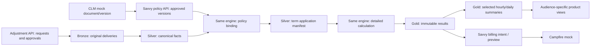

# Two products, one policy-driven billing engine

Current audience and UX scope: [Three audiences](THREE-AUDIENCE-PLAN.md), reviewed
with Astra and Sol on 15 November 2026. It supersedes the separate external
journeys and generic internal workspace below, adding focused Finance cash
matching and recognition visibility. Technical invariants remain in force.
These audience revisions are planned, not part of the delivered milestone.

Implementation status: see [the delivered milestone](MEDALLION-MILESTONE.md)
and [validation](VALIDATION-MEDALLION.md). The planning-only wording below records
the authorization boundary when this document was prepared; the owner later
explicitly authorized implementation after Astra's final review.

Planning only — 15 November 2026. Prepared by root with GPT-6 Astra after the
owner's medallion and commercial-optionality direction. Baseline reviewed:
e168ced61854e380f34effd07f90a0bf805d264c. This document does not implement,
activate or deploy the proposed behavior. No runtime, data or application-code
change is authorized by this planning artifact.

## Hard requirements

1. **One billing engine for both products and every economic component.** Client
   advisory fees, advisor compensation, platform charges, custodial economics,
   guarantees, credits and coverage use the same deterministic evaluator.
2. **Commercial changes are versioned policy changes through the API.** Rates,
   formulas, tiers, eligibility, dates, combinations, allocations, caps/floors,
   guarantees, supported day-count/proration conventions, cadence and netting
   are declarative policy data. No product-specific billing classes, UI formulas,
   dbt pricing logic, manual database edits or deployment to change a deal.
3. Bronze preserves original authorized input; Silver normalizes facts and binds
   applicable policy; Gold retains detailed results and separately publishes
   rollups. Refresh cadence, accrual grain and billing cadence are independent.
4. Architecture and technical evidence are **internal only**. External advisors
   and independent-RIA customers see their terms, amounts, value and explanations.
5. Both product journeys use the very same results as the internal walkthrough.
   No hardcoded presentation totals or second value/ROI calculator.
6. All new examples are fictional. Their terms are not statements of Savvy pricing.
   Campfire, CLM, network and settlement adapters remain local mocks. No new spend,
   real data collection, payment, signature or provider write is in this milestone.
7. Preserve prior records, source revisions, runs, reviews, tests and the current
   fixed-date workspace. A new scenario namespace must not redate November history.
8. One-time charges, credits and compensation entitlements enter as governed
   events through the same engine. Payment requests and payment evidence remain
   distinct. Statements are derived views, never an alternative monetary authority.

## Milestone outcome and audiences

Deliver a coherent explanation of two commercial products backed by replayable
sample data through the complete pipeline:

| Audience/context | Primary journey | Expected answer |
|---|---|---|
| Clients: brokers under either product | Shared Overview; Clients; Statements; Agreements | What does my business owe or earn, why, what changed, and what is paid or pending? |
| Internal Product | Account and contextual change workflow; record/service lineage | How does the design support flexible terms and prove each result through actual records and services? |
| Internal Finance | Cash matching and revenue recognition within entity/period/currency context | What was observed, applied, unresolved, scheduled or posted, and what evidence supports it? |

The independent RIA is a distinct institutional customer, not an affiliated
advisor or an investor. Do not create a general investor portal in this milestone.
The model and statement projection must preserve investor allocations separately
so a future investor view is possible without changing calculations.

## Internal architecture explanation

Use the current PostgreSQL/Rails/Next/dbt stack. Medallion is a responsibility and
data-versioning design, not a requirement to purchase Databricks, add a second
database, or introduce cloud compute. Keep original fixture bytes with stable
artifact identity and an immutable ingestion envelope; table/schema choices must
preserve this logical contract.

**Authority:** Rails owns operational parties, agreements, policy lifecycle,
reviews and commercial billing objects. Its approved policies are projected into
Silver. Source adapters ingest and normalize; they do not compute fees. One Ruby
billing interpreter binds policy and calculates all monetary components. dbt
selects current result revisions, rolls up additive outputs and checks quality;
it never interprets commercial policy, calculates pricing or originates obligations.
Billing consumes approved result identities. Refreshing data creates no invoice,
custodial instruction, journal or payment.

Current `CommercialEngine`/legacy requests must converge on this canonical
evaluator through compatibility translation, or serve preserved historical
results. Do not keep a second active calculator for either new product. The Python
reference remains an offline historical reference, not a runtime alternative.

## Layer contracts and grains

| Dataset | Grain and retained information |
|---|---|
| Bronze artifact/delivery | Original file/message and each arrival envelope; source identity/native record and revision IDs, original bytes/hash, published/as-of/received timestamps, type/version, coverage and correction references. Preserve unknown fields, duplicates and rejected rows with provenance. Never retain transport credentials as business payload. |
| Silver facts | Versioned balance/position observations, events, signup/service starts, source-observed rates, allocation reports, approved one-time economic adjustments and independently reported payments/receipts. Scoped mappings for legal entities, RIA firms, advisors, investors, households and accounts. Native currency/unit and original-source references survive normalization. |
| Silver term application | Fact/subject + applicable policy/component program + dated assignment + cutoff. The **same billing engine** resolves supported eligibility/replacement predicates. Retain candidates, reasons, policy/document/version and source basis. Aggregate-dependent schedules are bound here; their numerical tier/cap/floor outcome is evaluated later by the same engine. |
| Gold detail | Immutable run + component + accountable parties/direction + subject/allocation + economic interval/event + currency/unit. Retain exact basis/intermediates, policy and operator version, selected source revisions, rounding/allocation and supersession/adjustment references. |
| Gold publication/rollup | Selected logical-result revisions by economic period, product, party, component, currency, knowledge cutoff and manifest. Record freshness, coverage, known subtotals and blocked dependencies. Hourly publication versions are not new additive earnings. |
| Billing intent | A separately approved reference to detailed results and legal counterparties. Preserve charge, credit and netting identities. No new issuance/execution actions in the first proof. Preview documents are not proof of payment or accounting recognition. |
| Statement projection | Audience-scoped lines referencing selected Gold obligations/adjustments and independently evidenced payment applications. Recurring and one-time items share one view; totals are derived, not manually entered. Retain document/version, posting period, economic period and opening/closing balance reconciliation. |

Results have separate axes: calculation completeness; estimated/assessed economic
state; source-reported evidence; receipt/settlement evidence. An amount can be
fully calculated and still unreceived. Unknown is not zero. Snapshot balances
are stocks; monetary accruals/events are flows. Obligations, documents and
settlements are representations of the same economics, not extra revenue.

Declare intermediate/explanation, terminal charge/credit and summary outputs in
the policy graph. A capped $250 charge replaces its $200+$60 inputs as the branch's
terminal assessed charge; a summary cannot add all three. Likewise $3,135 fee share
plus $165 topup explains $3,300 compensation, not $6,600. The same lineage/selection
rules govern cumulative value comparisons and gross-versus-net presentations.

## One engine; policy changes through the API

A policy version is a typed, declarative component dependency graph. It specifies:

- Product/party/subject scope and payer/payee/legal-entity direction.
- Basis measurement references, units, currency and account/household aggregation.
- Operator composition and parameters, rate/tier references and eligibility.
- Effective dates, event-relative windows and business calendar/timezone.
- Day-count, valuation, rounding, proration and assessment/billing policies.
- Replacement groups, permitted additive groups and dependency ordering.
- Allocation, caps/floors, guarantees, coverage and authorized netting.
- Data-completeness/receipt prerequisites and agreement/document/review references.

Use one shared commercial rate store for standard, promotion and targeted rate
rows, referenced by component/policy version. Broaden its component/unit semantics;
do not encode every price as a 0–100% advisor share or create separate rate stores
per product. Fixed amounts, unit prices, tier bands and limits are typed policy
parameters. Source-observed yields remain evidence, separate from negotiated terms.

The stable interpreter vocabulary covers typed arithmetic, conditional selection,
dated/event predicates, aggregation, progressive bands, allocations, limits and
coverage. Ordinary business formulas are compositions of those primitives in
policy data; new templates are policy records, not plugins or Ruby subclasses.
Use no arbitrary Ruby/SQL/JavaScript, executable expression strings or unbounded
recursion. Validate dimensions, acyclic dependencies, scope, dates, coverage,
combination ambiguity and resource limits before a policy can run.

Commercial formulas are compositions, not individually coded product operators:
progressive fees sum bounded balance slices multiplied by their referenced rates;
a cap is min(selected group, limit); a guarantee is max(0, floor minus eligible
compensation); a spread uses two declared rates on a common basis; a rebate is a
rate times a scoped set of qualifying receipt amounts. The vocabulary also needs
typed temporal/evidence selection and conserved allocations, not arithmetic alone.

A new engine primitive is an exceptional platform capability change with reviewed
semantics and test vectors, not the normal route for changing commercial terms.
Unsupported policy must fail validation explicitly; accepting a JSON field is not
evidence that the engine supports its economics.

**Rounding and basis are explicit API policy, not implicit product defaults.**
Materialize required calendar/day-count/basis/rounding settings into the normalized
policy before review. Draft-schema defaults can assist authoring, but approved
policies and manifests must contain the actual selected settings. Each dependency
names exact accrual, assessed amount or source-reported amount; a generic amount
reference cannot silently substitute one basis for another. The sample walkthrough
pins complete assessment/rounding conventions and independent cent-boundary vectors.

Proposed additive API surface, using the existing command/idempotency envelopes:

| Operation | Required behavior |
|---|---|
| Save policy version | Immutable draft, typed components, expected base version/hash; never edits a published policy. |
| Assign policy | Versioned party/account/product scope and effective interval; date/priority conflict checks. |
| Compare policies | Same frozen input manifest and periods for both policy versions; readable component deltas and explicit scenario assumptions. |
| Review/publish policy | Bind exact policy, comparison, mock document/version and approval requirements. Changed dependencies invalidate affected approval. Publishing may schedule a future version. |
| Submit/review one-time event | Retain the request and its revisions; approval binds exact amount, parties, reason, policy version and event version. Approved events enter the canonical pipeline; no direct statement-total edit. |
| Record payment evidence/application | Authorized mock source adapter retains reported cash facts. Apply confirmed eligible evidence to a scoped obligation, preserving direction, currency, amount and remaining unapplied balance. A payment request is never payment evidence. |
| Evaluate sample pipeline | Internal only; allowlisted fixture case/cutoff and pinned policy versions, not caller-supplied source URLs or scripts. Same engine performs binding and calculation. |
| Read product economics | Return audience-authorized Gold results and readable terms/bases; no internal raw payloads or architecture details. |
| Read pipeline evidence | Internal only; stage rows, selected revisions, completeness, explainability and lineage for a case/run. |

Both product cases and their baseline comparisons must change through these APIs
without a source-code edit, image rebuild or frontend deployment. Frontend forms
render supported policy schemas; they do not evaluate commercial expressions.

## Bounded next proof; extensible commercial model

Required executable compositions for this milestone:

1. Annual balance accrual with fixture ACT/365 and exact rational rates;
   proportional amounts, explicit rate differences and progressive marginal bands.
2. Monthly fixed amounts and per-account-month prices with explicit eligibility.
3. Source-reported amount references and scoped allocations/rebates.
4. Dated/product/party/event eligibility; first-N-days from a supplied signup;
   replacement priorities plus explicitly additive independent components.
5. Named aggregate caps, period compensation floors and declared evaluation order.
6. Evidenced prior-funded advance/eligible entitlement coverage with bounded use.
7. Same-party/entity/currency authorized netting preview, preserving both directions.
8. Exact same-input policy comparisons and late-correction dependency recalculation.
9. Currency/unit validation and separate-currency output partitions. Both golden
   cases are USD; no implicit FX conversion or cross-currency total.
10. Approved one-time charges/credits/compensation, policy-controlled aggregate
    inclusion, linked post hoc corrections and separately evidenced payments.

Represent richer agreements using the same policy contract. Whole-balance tiers,
other day-count/proration conventions, rolling/pooled bases, complex multi-period
guarantees, FX, attribution waterfalls and amortizing loans are capability cases to
evaluate against the common primitive vocabulary. Mark each combination supported
and tested, or blocked with a specific missing capability. Do not narrow the data
model to the two fixtures, and do not promise every bespoke clause executable in
this first proof. A universal visual contract editor is outside this milestone.

## Time, corrections and reproduction

- Preserve source-native frequency and UTC timestamps plus named business timezone.
  UI last-day dates map to stored half-open intervals.
- The sample uses daily balance accrual, event/source-statement components and
  calendar-month fixed amounts/guarantees. Hourly refresh is a publication cadence.
- One logical economic result is selected once for a rollup. Repeated hourly
  refreshes do not accumulate daily/monthly estimates as additional fees.
- Freeze raw/fact revisions, mappings, policy/assignment versions, engine version,
  cutoff, calendar and scenario assumptions in a reproducible manifest.
- Late balances or backdated policy create new versions, affected-period reruns
  and separately typed differences/adjustment intents. Recompute dependent monthly
  guarantees/caps, not only the changed day. Original outputs/documents survive.
- A complete September service period is not a Finance accounting close. Campfire
  accounting authority and actual period-lock policy remain separate.

## One-time, ad hoc and post hoc event intake

Use a governed adjustment/event register as a parallel **input source**, feeding
the same Bronze → Silver → engine → Gold path as network deliveries. It is not a
second billing calculator. The unified statement table is a read-only projection
of these results and payment applications, not a separately writable ledger of
advisor totals. Savvy owns the underlying obligations, invoice lines, credit
adjustments and payout instructions; Campfire and CLM remain mocked consumers or
linked evidence, not the authority for Savvy's commercial amounts.

The lifecycle is request/draft → exact-event approval → eligible canonical event
→ same-engine assessment → Gold → statement projection. Bronze retains arrivals,
including unapproved, rejected and duplicate submissions; approval controls economic
eligibility, not whether history survives. Authorized source adapters can retain
externally reported payment facts without inventing an internal commercial approval.
Approving an instruction to pay still does not establish that payment happened.

Distinguish these event semantics explicitly:

| Event meaning | Economic treatment |
|---|---|
| One-time charge or credit | Creates or adjusts a declared obligation under published policy; links original result/invoice when applicable. |
| One-time compensation entitlement | Creates an amount owed to an advisor; policy determines guarantee/floor and other group inclusion. No cash movement is implied. |
| Payout instruction/request | Records intent and requested/scheduled status, referencing obligations. No extra earnings or reduction of payable merely because it was requested. |
| Reported payment/receipt | Independent evidence of money movement. Only confirmed, eligible, scoped application reduces an obligation; pending or unallocated cash remains separate. |
| Reversal/replacement | Links the original event and negates its assessed effect/application under the contract; correction does not overwrite history or execute a refund. |

Minimum event contract: scoped source/event ID and revision; typed event meaning;
positive magnitude with explicit direction and currency; legal debtor, creditor
and recipient; account/service/subject scope; reason code and readable explanation
with evidence; service window/economic effective date; source, received/recorded
and approval timestamps; requested and authorized posting period; policy/version;
original obligation/invoice/result where relevant; approval binding where required;
reversal/replacement links and command idempotency key. Reject conflicting payloads
for one identity. Duplicate deliveries preserve history but have only one
authoritative economic effect. Amounts and scope cannot change under an old approval.

A permitted one-time event uses an existing published event policy: a new bonus
does not inherently need a new policy. Changed commercial treatment does require
a reviewed version through the policy API. Policy controls fee-share eligibility,
cap/floor/guarantee groups, rebate basis, coverage, billing/netting and statement
classification. No universal signed adjustment or arbitrary checkbox bypasses
these rules. An exceptional deal can use a reviewed event/party/period-scoped
policy version. Keep the graph acyclic and select terminal outputs once. Unsupported
tax or other treatment blocks explicitly rather than being silently inferred.

Retain service time, source event time, received/recorded time, approval time and
posting authority separately. A backdated internal event cannot appear as known
before its required approval. Finance rules authorize posting periods; an old
service date cannot reopen a sealed period. Preserve original results/documents,
append linked adjustments and publish a new statement version. The first proof
uses sealed historical fixtures and posting previews, not live issuance or a
new accounting-period management integration.

A credit reduces an obligation or creates a credit balance; it is not automatically
a cash refund. A refund needs a separately supported entitlement/instruction and
independent execution evidence. Likewise, a confirmed payment reduces remaining
payable only through a valid allocation; it does not create new earnings, advance
rights or commercial benefit. Reversals must not duplicate either the obligation
or the money movement.

External statements combine recurring amounts, one-time items and payment status
using labels such as Bonus, Service credit, Advance applied and Payment applied.
Show reason, service/posting period, date and status; keep internal approvals and
raw provenance in the internal experience. Reconcile opening balance + new amounts
owed − applicable credits/coverage/payments = closing balance by party, direction
and currency, preserving any authorized netting without obscuring its gross lines.

## Screens and explanation requirements

**Internal Architecture:** one concise diagram, authority boundaries, layer grains,
economic/knowledge/approval/posting clocks, one-engine/API-policy rule, example handoffs and supported capability
catalog. It explains why the architecture solves the two products' economics.

**Internal Data pipeline:** case and as-known cutoff selectors, stage summaries,
sample rows, policy bindings, exact Gold results, selected hourly/daily publications
and exceptions. A selected external amount can be followed back through each stage.
Correction/pending/duplicate cases belong here or in proposal comparison detail.
Avoid an unexplained dump of identifiers; technical evidence can expand on demand.

**Affiliated-advisor Earnings:** fee-share compensation, promotion effect, guarantee
topup, total compensation, advance already received and remaining payment status.
Human customer/term explanation and a same-input baseline comparison show value.

**Independent-RIA Platform economics:** platform charges, account-related qualified
credits, net amount due and status; account/product explanation; cap benefit and
same-input term comparison. Investor benefits/costs are separately attributable
context, never added to the firm's income or netted invisibly into its bill.

Keep architecture, medallion/dbt vocabulary, raw records, manifests and operator
versions off external screens. Preserve official branding, ordinary date labels
and clean product copy. Put fixture/unsupported-integration context in the internal
presenter view and documentation, not repeated external demo banners. Never claim
real Savvy pricing, executed agreements, market outperformance, time ROI, profit,
payment or recognition without the corresponding evidence.

## Implementation sequence and acceptance

| Phase | Deliverable | Acceptance gate |
|---|---|---|
| 0 | Freeze this contract and sample walkthrough | Independent arithmetic; program/schema and capability matrix; all fictional conventions explicit. |
| 1 | Additive Bronze/Silver datasets, policy API and adjustment intake | Lossless replay; duplicates/corrections and unapproved arrivals retained; scope, approval and known-time selection; API-authored policies/assignments. |
| 2 | One engine binding/evaluation path and Gold detail | Both cases and baseline programs are data; no per-product fee code; exact figures, dependency ordering and blocked cases. Legacy commands translate to same engine or retained results. |
| 3 | Gold rollups, unified statement projection and billing intents/previews | Hourly replay leaves economics/intents unchanged; recurring and one-time lines derive from selected results; payment applications remain distinct; no refresh originates a bill/payment or accepts an alternative statement total. |
| 4 | Two external product stories and internal views | Same result IDs/numbers throughout; readable explanations; no internal data in external API; existing UI-feedback constraints preserved. |
| 5 | Policy-only change and resilience demonstration | Change rebate 40%→50% through API: credit $120→$150 and net due $130→$100. Add $50 monthly component outside the capped group by API: due $180 under original rebate policy. Replace the fixed+account-count charge graph with a 0.06% annual ACT/365 balance-based graph on $3.65m: charge $180, net due $60. Same engine/code/build and facts; prior versions remain reproducible. |
| 6 | Integrated review and release preparation | Existing regression, new operator/rounding vectors, HTTP scope tests, desktop/mobile, fresh schema, migration/restore rehearsal and unchanged historical rows. Deployment is a later authorized action. |

Additional mandatory cases: missing balance day/signup, ambiguous overlapping
promotion, same amount/new source revision, duplicate replay, stale evidence,
separate currencies, expired/insufficient/wrong-direction coverage, absent netting
authority, unsupported expression, policy dependency cycle, source receipt reversal,
and a correction changing a monthly guarantee without changing final compensation.
Also require unapproved/rejected adjustment retention, late approval and posting
selection, conflicting duplicate events, bonus inclusion/exclusion in guarantees,
pending/unallocated/wrong-direction versus valid applied payments, linked reversals,
credit versus refund distinction and preservation of a sealed historical statement.

Implementation must use isolated development/test state. Do not build or migrate
against the device-hosted retained database, edit live policies or restart its
services during planning/development. Gate the final candidate with the repository's
existing release process before replacing the hosted app.

## Readiness and remaining discovery

The sample conventions and exact target outputs are in
[MEDALLION-SAMPLE-WALKTHROUGH.md](MEDALLION-SAMPLE-WALKTHROUGH.md). They are design
fixtures, not executed pipeline results. Current architecture/gap evidence is in
the existing workspace milestone and source; the current pipeline does not yet
implement this document.

Production discovery still needs real network schemas, authoritative identities,
negotiated terms, valuation/carry-forward and rounding conventions, receipt
allocation evidence, disclosure permissions and correction/close rules. These do
not block the isolated fictional proof. Campfire and CLM remain mocks throughout.
